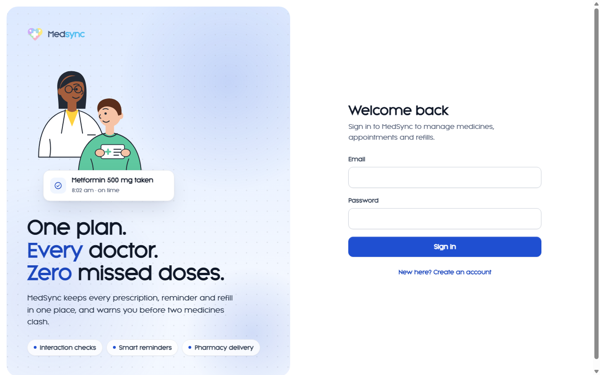
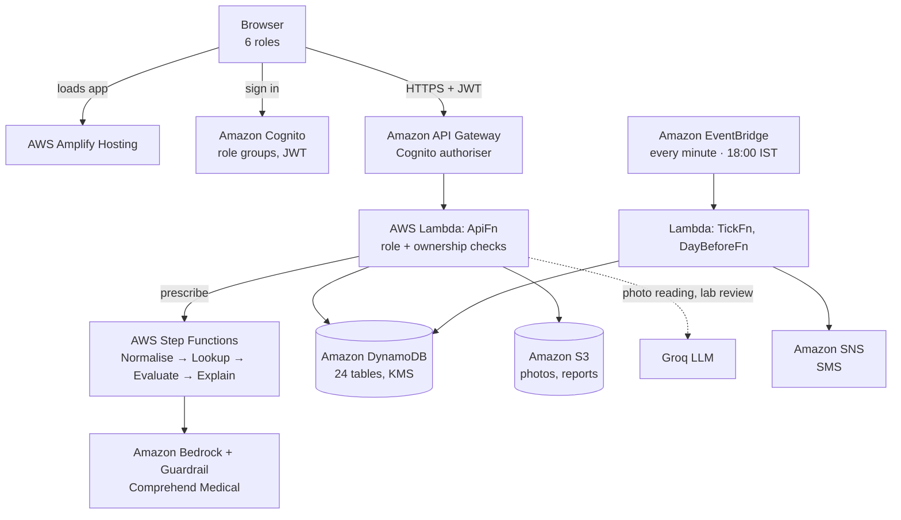

<div align="center">


# MedSync

**One medication record for every doctor, patient, caregiver, nurse, pharmacy and lab.**

Drug-safety checks driven by rules and data, not AI guesses. Built serverless on AWS.

[](https://main.d3v6xv609g8loz.amplifyapp.com)
[](LICENSE)


[Live demo](https://main.d3v6xv609g8loz.amplifyapp.com) ·
[Features](#features) ·
[Architecture](#architecture) ·
[Getting started](#getting-started) ·
[Safety design](#safety-design)



</div>

---

## Why MedSync

A patient with three doctors often has three separate medicine lists. Nobody sees the whole picture, interactions slip through, and doses get missed. MedSync gives everyone involved one shared, versioned record. Every new prescription is checked against the patient's allergies and **every active medicine from every doctor** before it can be saved.

## Features

| | Who it's for | What they get |
|---|---|---|
| 🩺 | **Doctors** | Prescribe, modify and stop medicines with live interaction, allergy and duplicate-therapy alerts. See the full history across all doctors and review uploaded prescription photos. Order lab tests and get **AI-suggested next steps** on finished reports. |
| 🧑 | **Patients** | Today's dose checklist with streaks and adherence heat map. Find a doctor by specialty and book in three steps. Photograph a paper prescription, order medicines, choose a lab, message the care team, and switch on **emergency mode**. |
| 🤝 | **Caregivers** | Accept an invite, follow a loved one's medicines and mark doses for them. Alerted after 2 missed doses in a row or adherence below 70%. |
| 🏥 | **Nurses / admins** | Register patients, doctors, pharmacies and labs. Manage insurance with full history, book appointments and work the day-before confirmation queue. Read-only on clinical data. |
| 💊 | **Pharmacies** | Order board from accept to delivered or collected, with quantities suggested from the prescription. |
| 🧪 | **Labs** | Work board, sample tracking, and results auto-flagged Low / High / Critical, with report upload. Critical values alert the doctor at once. |

**Across every role:** in-app notifications (SMS optional), maps and directions, light and dark themes, a large-text mode, and separate sign-ins per browser tab.

## Architecture



The whole backend is one AWS CDK stack (`infra/lib/stack.ts`), so `cdk deploy` builds everything from scratch.

<details>
<summary><b>AWS services and what each one does</b></summary>

| Service | Role in MedSync |
|---|---|
| **Amplify Hosting** | Serves the React app over HTTPS |
| **Cognito** | Sign-up and sign-in, strong password policy, optional TOTP MFA, six role groups |
| **API Gateway** | One REST API (`/v1`) behind a Cognito authoriser, throttled |
| **Lambda** (Node.js 22) | The API (77 routes), scheduled jobs and the safety-workflow steps |
| **Step Functions** (Express) | The four-step drug-safety check, run synchronously |
| **DynamoDB** | 24 tables, on-demand, point-in-time recovery |
| **Bedrock** + **Guardrails** | Plain-language explanation of stored interaction records only |
| **Comprehend Medical** | RxNorm codes for traceability |
| **EventBridge** | Dose reminders and missed-dose checks every minute, appointment confirmations daily |
| **S3** | Private, versioned, KMS-encrypted store for prescription photos and lab reports |
| **KMS** | One rotating customer-managed key for tables, files and audit |
| **SNS** | SMS for urgent events (opt-in) |
| **SSM Parameter Store** | The Groq API key as a SecureString |
| **CloudTrail**, **CloudWatch**, **X-Ray** | Audit trail, logs and tracing |
| **HealthLake**, **Timestream**, **CloudFront** | Built in, off by default (CDK flags) |

</details>

## Safety design

MedSync uses AI to **explain and read**, never to **decide**.

- **Rules decide.** Interactions, allergies (by ingredient and class) and duplicate therapy are checked by plain TypeScript rules against a curated dataset (`backend/src/domain`).
- **No free text.** Every drug, form and strength must exist in the catalogue.
- **Checked again on save.** The server re-runs the safety workflow and never trusts alerts sent from the browser.
- **Serious alerts need a reason.** Major, Contraindicated and allergy alerts block saving (HTTP 409) until the doctor records why.
- **Careful wording.** The neutral result is *"No known interaction found in our database"*, never *"safe"*.
- **Immutable history.** Every change is a new version row and nothing is overwritten.
- **Append-only audit.** IAM lets code only add and read audit events, never change or delete them. Denied attempts are logged too.
- **AI is advisory and fenced.** Bedrock explanations run at temperature 0 behind a Guardrail. Lab-report suggestions are shown to the doctor only and receive de-identified data. Every AI step has a non-AI fallback.

## Getting started

### Prerequisites

- Node.js 22+ and npm
- An AWS account with credentials configured (`aws configure`) in a region with Bedrock and Comprehend Medical, e.g. `us-east-1`
- Access to your chosen Bedrock model enabled in the Bedrock console
- Optional: a [Groq](https://groq.com) API key for prescription-photo reading and lab-report suggestions

### Install and test

```bash
git clone https://github.com/tanish2450/MedSync.git
cd MedSync
npm install
npm test            # 60 unit tests, no AWS needed
```

### Deploy the backend

```bash
cd infra && npx cdk bootstrap        # once per account and region
cd .. && npm run deploy              # builds the frontend, then deploys the stack
# serving the frontend from another HTTPS host (e.g. Amplify)?
# npx cdk deploy -c siteUrl=https://your-site.example.com
```

Optional: store the Groq key.

```bash
aws ssm put-parameter --name /medsync/groq-api-key --type SecureString --value <your-key>
```

### Seed demo data

```bash
SEED_PASSWORD='Choose-A-Strong-Pw-1!' npm run seed
```

This creates the drug catalogue, the interaction dataset and fictional demo users (`dr.shetty@example.com`, `pt.ramesh@example.com`, `cg.ramesh@example.com`, `nurse.demo@example.com`, `pharmacy.demo@example.com` and more). No emails are sent.

### Run the frontend locally

```bash
cp frontend/public/config.example.json frontend/public/config.json   # fill in the stack outputs
npm run dev -w frontend
```

<details>
<summary><b>Optional CDK flags</b></summary>

| Flag | Effect |
|---|---|
| `-c siteUrl=https://…` | Allow an external HTTPS host for CORS and Cognito callbacks |
| `-c cloudfront=true` | Serve the site through CloudFront |
| `-c smsEnabled=true` | Send SMS through SNS (needs SNS sandbox exit) |
| `-c healthLake=true` | Sync prescriptions and allergies to HealthLake as FHIR R4 |
| `-c timestream=true` | Write adherence time series to Timestream |
| `-c bedrockModelId=<id>` | Choose the Bedrock model for explanations |
| `-c google=true -c googleClientId=<id>` | Google sign-in (secret in Secrets Manager) |
| `-c destroyOnDelete=true` | Delete data when the stack is deleted (teardown only) |

</details>

## Try it

1. **Interaction alert.** Sign in as `dr.shetty`, open *Ramesh Iyer* (on warfarin) and prescribe aspirin. A Major alert appears, and saving needs a reason.
2. **Allergy block.** *Lakshmi Devi* (penicillin allergy) + amoxicillin.
3. **Contraindicated.** *Arjun Mehta* (isosorbide) + sildenafil.
4. **Adherence escalation.** Sign in as `dr.rao`: Ramesh is flagged after two missed warfarin doses, and his caregiver was alerted.
5. **Lab report with AI suggestions.** Order a test as a doctor, enter results as the lab, then read the suggested next steps on the doctor's lab card.

## Project structure

```text
MedSync/
├── backend/           Lambda handlers, business rules and tests
│   ├── src/domain/    pure rules: interactions, allergies, doses, slots, labs, AI parsing
│   ├── src/handlers/  API router and routes, one file per area
│   ├── src/lib/       AWS clients, notifications, audit, Groq
│   ├── src/workflow/  Step Functions safety steps
│   ├── src/seed/      drug catalogue, interaction dataset, demo data
│   └── test/          unit tests (node:test)
├── frontend/          React 18 + Vite single-page app
│   └── src/pages/     screens for each role
├── infra/             AWS CDK stack
└── docs/              images for this README
```

## Tech stack

**Frontend:** React 18, React Router 6, Vite 5, TypeScript, `amazon-cognito-identity-js`, Google Maps embeds, hand-drawn SVG illustrations
**Backend:** Node.js 22 on AWS Lambda, TypeScript, AWS SDK v3, Node's built-in test runner
**Infrastructure:** AWS CDK v2, esbuild bundling, AWS Amplify Hosting

## Limitations and roadmap

- [ ] Real-time updates with AppSync subscriptions (currently 15–30 s polling)
- [ ] Email, WhatsApp and push notifications (in-app is live, SMS is opt-in)
- [ ] MFA code entry in the UI
- [ ] OpenSearch for patient and drug search at scale
- [ ] Licensed interaction database (the bundled dataset is a hand-curated demo set of 46 records)
- [ ] Move lab-report suggestions to Bedrock so all data stays in AWS

> **Not for clinical use.** MedSync is a hackathon project. The interaction dataset is for demonstration only and has not been clinically reviewed. All demo data is fictional. Before real patient data, review India's DPDP Act 2023 data-residency rules.

## License

[MIT](LICENSE) © 2026 tanish2450
